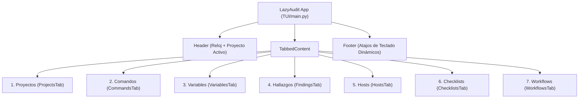
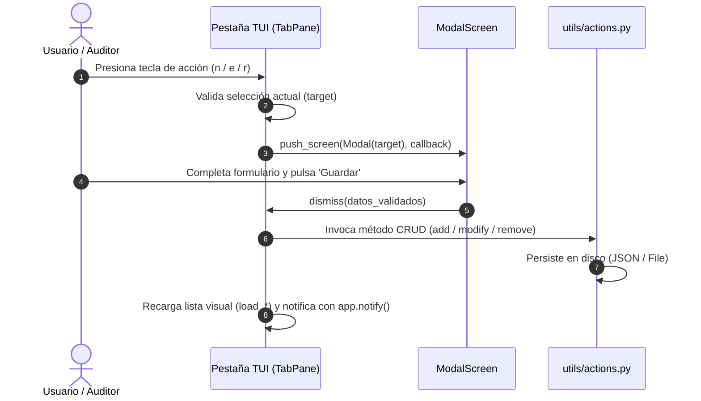

# Documentación Técnica y Funcional: TUI de LazyAudit

Documentación integral de la **Interfaz de Usuario de Texto (TUI)** de LazyAudit desarrollada con el framework **Textual** y **Rich**, cubriendo su arquitectura visual, navegación, bindings de teclado, modales y sincronización de datos.

---

## 1. Arquitectura General y Layout

La TUI se organiza en una ventana única con pestañas ([`TabbedContent`](file:///home/luciano/github/LazyAudit/TUI/main.py#L32)), encabezado con reloj y título dinámico según el proyecto activo, y un pie de página ([`Footer`](file:///home/luciano/github/LazyAudit/TUI/main.py#L47)) contextual que refleja los atajos disponibles en cada pestaña.

### Patrón de Diseño en Dos Columnas
Todas las pestañas siguen un patrón visual simétrico y predecible:
- **Columna Izquierda (Navegación / Listado):** Tabla de datos (`DataTable`) o lista interactiva (`ListView`) con cursor navegable mediante flechas `↑` y `↓`.
- **Columna Derecha (Detalle / Inspección / Consola):** Paneles de información enriquecida con etiquetas dinámicas (`Label`) o consola en vivo (`RichLog`).

---

## 2. Detalle de Pestañas y Funcionalidad

### 1. Pestaña: Proyectos (`ProjectsTab`)
- **Archivo:** [`TUI/tabs/projects.py`](file:///home/luciano/github/LazyAudit/TUI/tabs/projects.py)
- **Columna Izquierda:** Tabla de proyectos con Nombre y Estado (`ACTIVE`, `PAUSED`, `FINISHED`).
- **Columna Derecha:** Metadatos del proyecto (Nombre, Descripción, Fecha de Creación) y conteos consolidados de recursos asociados (Comandos, Variables, Hosts, Hallazgos, Checklists, Workflows).
- **Atajos (`BINDINGS`):**
  - `a`: Activar / Seleccionar proyecto (recarga en caliente todos los punteros vía `PATHS.reload_paths()`).
  - `n`: Crear nuevo proyecto (`AddProjectModal`).
  - `e`: Modificar proyecto activo (`ModifyProjectModal`).
  - `r`: Eliminar proyecto (`RemoveProjectModal`).

---

### 2. Pestaña: Comandos (`CommandsTab`)
- **Archivo:** [`TUI/tabs/commands.py`](file:///home/luciano/github/LazyAudit/TUI/tabs/commands.py)
- **Columna Izquierda:** Tabla de títulos y ámbitos (`GLOBAL` / `PRIVATE`).
- **Columna Derecha:** 
  - Título y Descripción.
  - **Plantilla Raw:** Comando con sintaxis de interpolación (ej: `nmap -sV {RHOST}`).
  - **Renderizado en Vivo:** Comando evaluado e interpolado con los valores actuales de las variables activas.
  - Etiquetas / Tags.
- **Atajos (`BINDINGS`):**
  - `n`: Nuevo comando (`AddCommandModal`).
  - `e`: Editar comando (`ModifyCommandModal`).
  - `r`: Eliminar comando (`RemoveCommandModal`).

---

### 3. Pestaña: Variables (`VariablesTab`)
- **Archivo:** [`TUI/tabs/variables.py`](file:///home/luciano/github/LazyAudit/TUI/tabs/variables.py)
- **Columna Izquierda:** Tabla con `Clave` y `Scope`.
- **Columna Derecha:** Detalle de Clave, Valor actual, Descripción y Ámbito.
- **Atajos (`BINDINGS`):**
  - `n`: Nueva variable (`AddVariableModal`).
  - `e`: Editar variable (`ModifyVariableModal`).
  - `r`: Eliminar variable (`RemoveVariableModal`).

---

### 4. Pestaña: Hallazgos (`FindingsTab`)
- **Archivo:** [`TUI/tabs/findings.py`](file:///home/luciano/github/LazyAudit/TUI/tabs/findings.py)
- **Columna Izquierda:** Tabla de vulnerabilidades agrupadas por Host y Severidad (`LOW`, `MEDIUM`, `HIGH`).
- **Columna Derecha:** Descripción detallada, severidad con coloración y lista de CVEs / vulnerabilidades asociadas.
- **Atajos (`BINDINGS`):**
  - `n`: Nuevo hallazgo (`AddFindingModal`).
  - `e`: Editar hallazgo (`ModifyFindingModal`).
  - `r`: Eliminar hallazgo (`RemoveFindingModal`).

---

### 5. Pestaña: Hosts (`HostsTab`)
- **Archivo:** [`TUI/tabs/hosts.py`](file:///home/luciano/github/LazyAudit/TUI/tabs/hosts.py)
- **Columna Izquierda:** Listado de activos descubiertos (Dirección IP y Hostname).
- **Columna Derecha:** Detalle de IP, Nombre de host, Puertos abiertos detectados y Servicios asociados.
- **Atajos (`BINDINGS`):**
  - `n`: Añadir host (`AddHostModal`).
  - `e`: Editar host (`ModifyHostModal`).
  - `r`: Eliminar host (`RemoveHostModal`).

---

### 6. Pestaña: Checklists (`ChecklistsTab`)
- **Archivo:** [`TUI/tabs/checklists.py`](file:///home/luciano/github/LazyAudit/TUI/tabs/checklists.py)
- **Estructura Jerárquica Sincronizada:**
  - **Izquierda (`#groups_list`):** Grupos metodológicos (ej: OWASP, Active Directory) con barra de progreso numérica `[completadas/totales]` y etiqueta de `Scope`.
  - **Derecha (`#tasks_list`):** Tareas pertenecientes al grupo enfocado con casillas interactivas `[X]` o `[ ]`.
- **Detección de Foco Dinámica (`get_selected_target`):**
  - Determina automáticamente si el auditor está operando sobre un **Grupo** o sobre una **Tarea individual**.
- **Atajos (`BINDINGS`):**
  - `Space`: Conmuta de forma inmediata el estado `[X]` / `[ ]` de la tarea y recalcula el contador del grupo sin perder la posición.
  - `n`: Si el foco está en Grupos, crea un grupo con su primera tarea (`AddGroupModal`). Si está en Tareas, agrega una tarea al grupo actual (`AddTaskModal`).
  - `e`: Edita el nombre del grupo (`ModifyGroupModal`) o la descripción/scope de la tarea (`ModifyTaskModal`).
  - `r`: Modal de confirmación para eliminar el grupo completo con todas sus tareas (`RemoveGroupModal`) o la tarea individual (`RemoveTaskModal`).

---

### 7. Pestaña: Workflows (`WorkflowsTab`)
- **Archivo:** [`TUI/tabs/workflows.py`](file:///home/luciano/github/LazyAudit/TUI/tabs/workflows.py)
- **Columna Izquierda (`#workflows_list`):** Listado de automatizaciones con detección automática de runtime (`[PYTHON]` / `[BASH]`), nombre del archivo y ámbito (`GLOBAL` / `PRIVATE`).
- **Columna Derecha:** Detalle de ruta absoluta y consola de ejecución en vivo integrada ([`RichLog`](file:///home/luciano/github/LazyAudit/TUI/tabs/workflows.py#L56)).
- **Ejecución Asíncrona sin Bloqueo:**
  - Emplea un worker en segundo plano (`@work(thread=True)`) conectado al generador `Workflow.run()`.
  - Transmite la salida (`stdout` y `stderr`) línea a línea en streaming directamente a la pantalla mientras el proceso se ejecuta, registrando el código de salida final (`0` o error).
- **Atajos (`BINDINGS`):**
  - `x`: Ejecutar el script seleccionado en vivo.
  - `n`: Añadir / Importar script local (`AddWorkflowModal`).
  - `r`: Eliminar workflow del proyecto o del almacén global (`RemoveWorkflowModal`).
  - `c`: Limpiar pantalla de consola.

---

## 3. Catálogo de Modales y Flujo de Interacción

Todos los modales heredan de `ModalScreen` y cuentan con navegación ergonómica en teclado:
- `Left` / `Right`: Conmutar el foco entre los botones de acción (`Guardar` / `Cancelar` o `Confirmar` / `Cancelar`).
- `Escape`: Cerrar el modal y cancelar la acción (`self.dismiss(None)`).

---

## 4. Estado de Verificación

- **Pruebas de montaje (`run_test`):** Todas las pestañas y widgets montan de manera limpia, sin colisión de IDs ni excepciones de ciclo de vida.
- **Aislamiento:** La recarga de contexto (`Project.change`) actualiza las 7 vistas de forma consistente sin requerir reinicio de la aplicación.
- **Pendientes:** Ajuste estético final mediante hojas de estilo **TCSS** (colores de marca, paddings y cursores personalizados).
